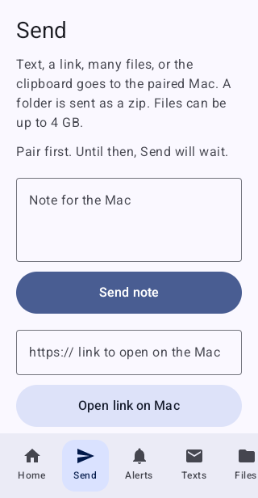
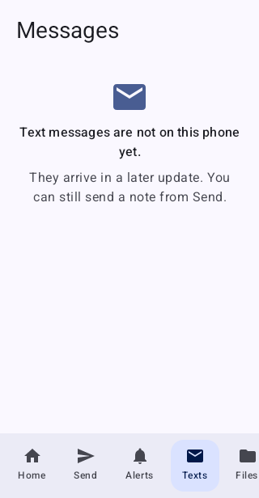
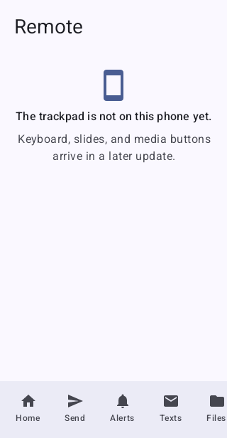
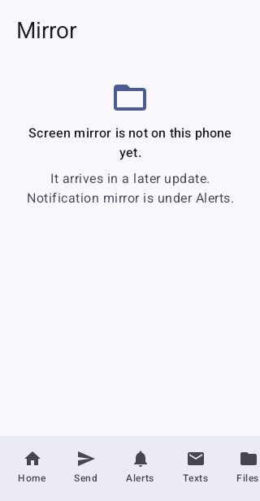
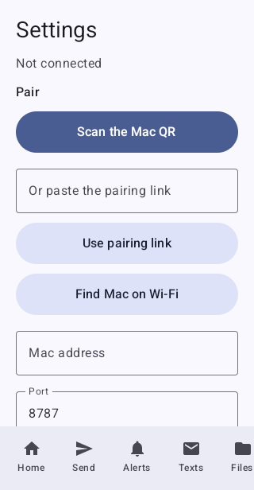
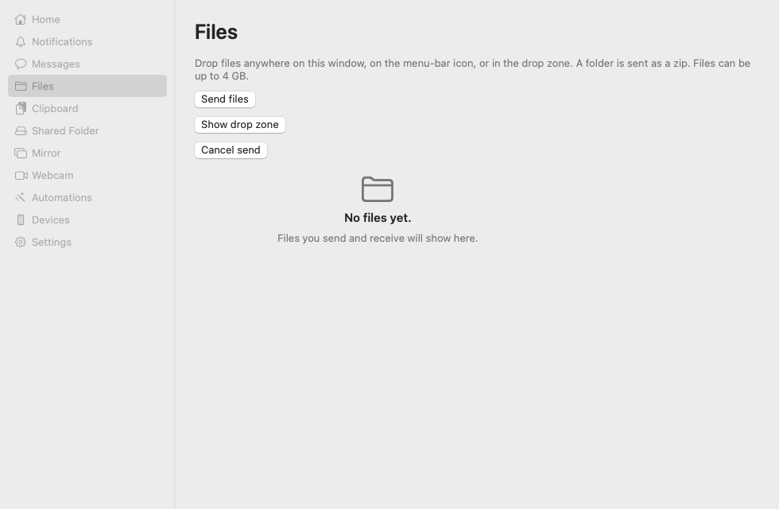
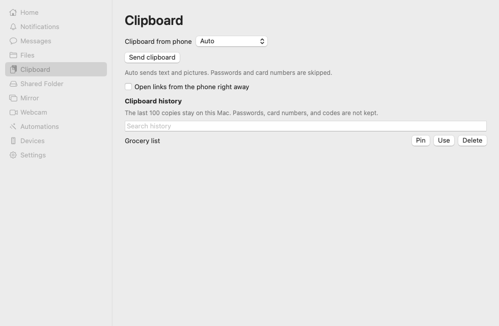
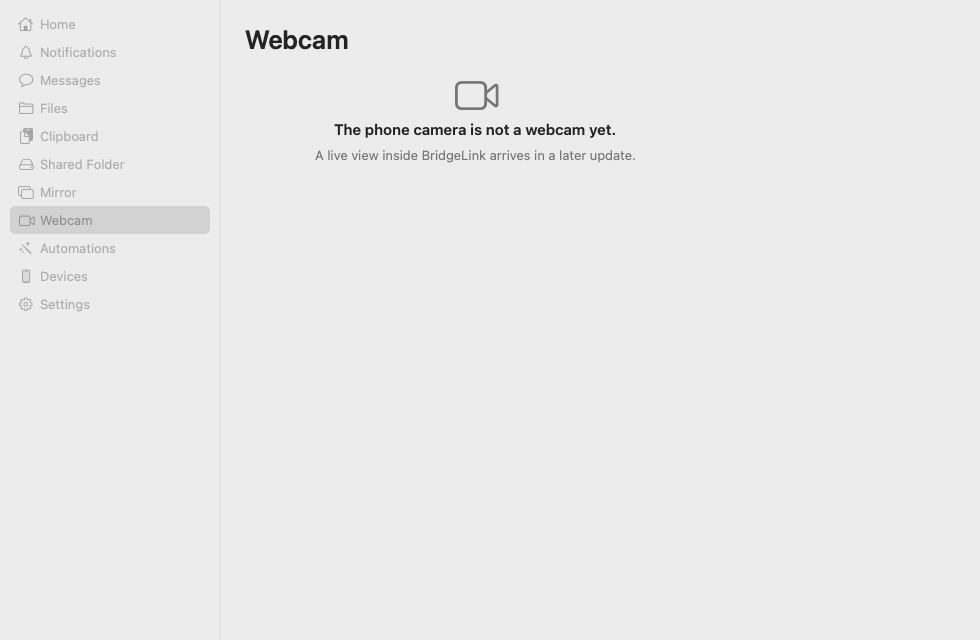
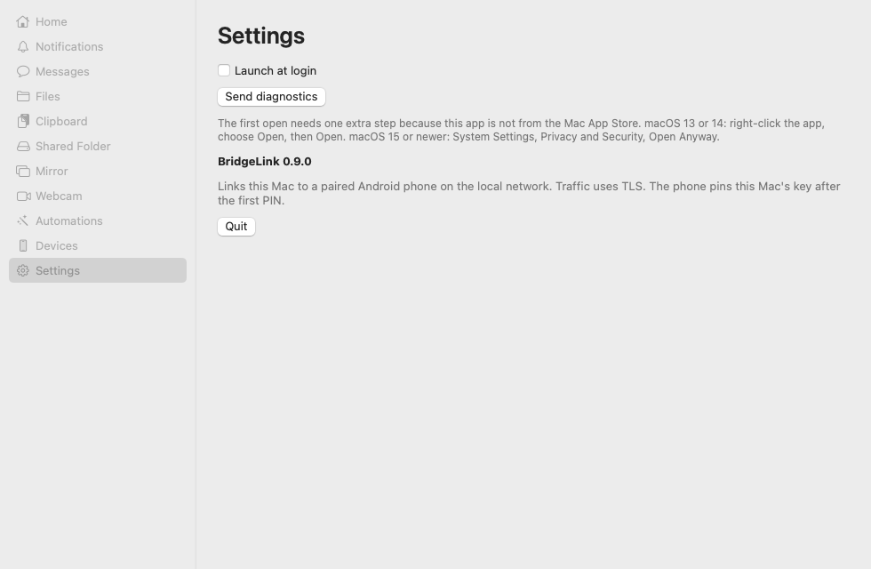

# BridgeLink

Installable link between an Android phone and a Mac menu-bar app.

Downloads: https://github.com/CAPPY7/bridgelink/releases/latest

The page at the root of this repo is a **simulated demo**. It does not talk to the phone or the Mac. The apps in `/android` and `/macos` are the product.

## Screens

Light and dark follow the system. A screen that is not built yet says so.

### Phone










### Mac menu bar


### Mac window











## Install

See [docs/INSTALL.md](docs/INSTALL.md) and [docs/USER_GUIDE.md](docs/USER_GUIDE.md).

## Status of the 25 features

Honest status of the **installable apps**. The demo is not counted. Status words are Not started, Building, Built – self-tested, or Final – owner tested. See [docs/FEATURE_MATRIX.md](docs/FEATURE_MATRIX.md).

| # | Feature | Status |
|---|---|---|
| 1 | Send files, links, and text | Built – self-tested. Files, folders as zip, up to 4 GB, progress, cancel, and resume |
| 2 | Share sheet and drag-drop | Built – self-tested. Android share sends many files. Mac drop, drop zone, Finder Services, and Share |
| 3 | Notification mirroring | Built – self-tested. Banners, reply when the app allows it, dismiss both ways, per-app block, Do Not Disturb option |
| 4 | Media control | Built – self-tested |
| 5 | Battery status | Built – self-tested. Both ways, plus low and full alerts |
| 6 | Find phone | Built – self-tested. Rings on the alarm stream so silent mode does not hide it. Either side can stop it |
| 7 | OTP auto-copy | Built – self-tested. Codes from notifications and SMS, cleared on the Mac after 60 seconds |
| 8 | Open a link on the other device | Built – self-tested. Both ways, with an always-open option |
| 9 | Trackpad, keyboard, slides | Built – self-tested. Drag, click, two-finger scroll, right-click, typing, slides, and a laser dot. The Mac needs Accessibility |
| 10 | Clipboard sync | Built – self-tested. On or off, skips sensitive text, sends small pictures |
| 11 | SMS | Built – self-tested. Read, send, banners, and a SIM choice. Allow SMS on the phone |
| 12 | Screen mirror | Not started |
| 13 | Control the phone while mirroring | Not started |
| 14 | Phone as webcam | Not started |
| 15 | Shared folder | Built – self-tested. Both ways, conflict copies, pause. Files over 32 MB are skipped |
| 16 | Lock the Mac when you leave | Built – self-tested |
| 17 | Away from home | Not started |
| 18 | Unified inbox | Built – self-tested |
| 19 | Clipboard history | Built – self-tested |
| 20 | Scan to Mac | Built – self-tested |
| 21 | Automations | Built – self-tested. Up to eight when-this-then-that rules |
| 22 | Quick drop | Built – self-tested. Quick Settings tile, menu-bar drop, and a floating drop zone |
| 23 | Pairing | Built – self-tested. QR, several phones and Macs, rename, and forget |
| 24 | End-to-end encryption | Built – self-tested. TLS on the local link. New features use that same link |
| 25 | Key pin | Built – self-tested. If the Mac key changed, forget it and scan again |

## Build

```bash
cd android && ./gradlew test assembleDebug
bash macos/build.sh
```

The Mac build needs macOS 15 and produces a universal app, or it fails. It does not silently drop the Intel slice.
