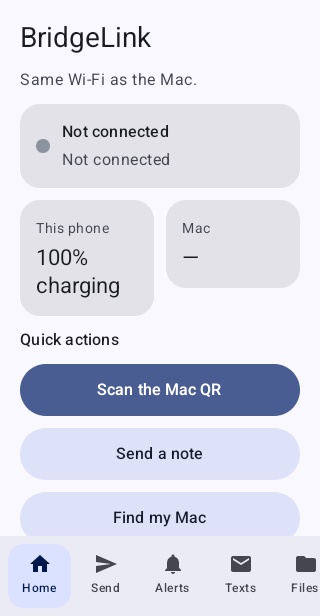
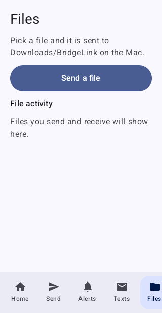
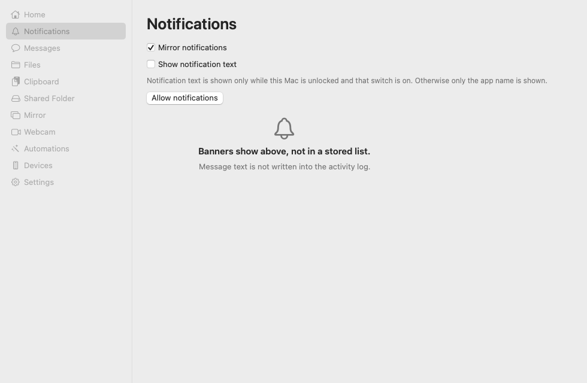
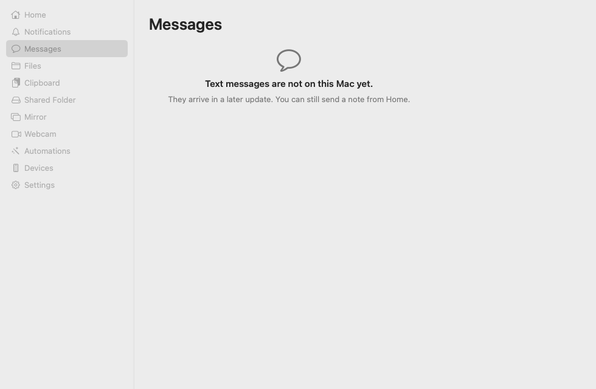
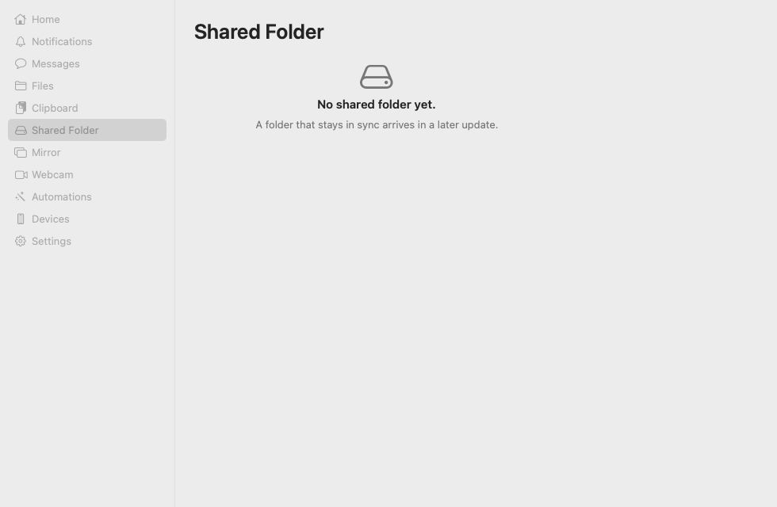
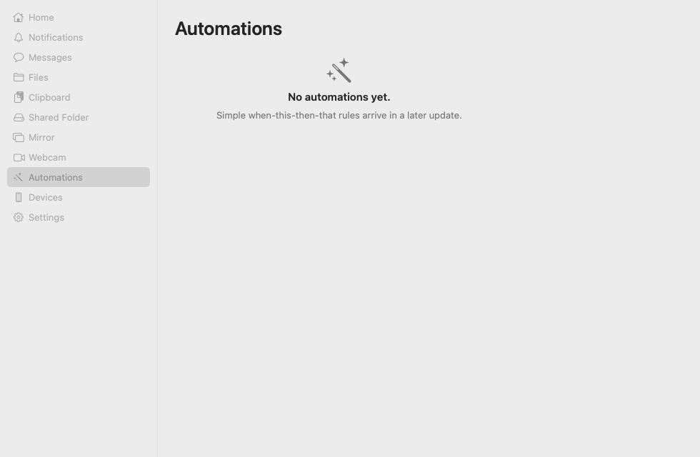

# BridgeLink

Installable link between an Android phone and a Mac menu-bar app.

Downloads: https://github.com/CAPPY7/bridgelink/releases/latest

The page at the root of this repo is a **simulated demo**. It does not talk to the phone or the Mac. The apps in `/android` and `/macos` are the product.

## Screens

Light and dark follow the system. A screen that is not built yet says so.

### Phone







### Mac menu bar


### Mac window












## Install

See [docs/INSTALL.md](docs/INSTALL.md) and [docs/USER_GUIDE.md](docs/USER_GUIDE.md).

## Status of the 25 features

Honest status of the **installable apps**. The demo is not counted. Status words are Not started, Building, Built – self-tested, or Final – owner tested. See [docs/FEATURE_MATRIX.md](docs/FEATURE_MATRIX.md).

| # | Feature | Status |
|---|---|---|
| 1 | Send files, links, and text | Building. Text both ways. Files both ways with a hash check, a 100 MB cap, sanitized names, and resume from the last saved offset |
| 2 | Share sheet and drag-drop | Building. Android share sheet sends text, a link, or one file. The Mac menu-bar icon and the panel accept a dropped file |
| 3 | Notification mirroring | Building. The phone can mirror after you turn it on. On Android 13+ a sideloaded app needs Allow restricted settings first; the app shows the steps. The Mac shows the full text only when it is unlocked and Show notification text is on. Otherwise it shows the app name. Reply and dismiss are not done |
| 4 | Media control | Not started |
| 5 | Battery status | Building. The phone sends its level when it pairs. The Mac shows it. The Mac battery is not sent yet |
| 6 | Find phone | Building. Rings at alarm volume, can vibrate, stops from the phone or the Mac, and the phone can ring the Mac |
| 7 | OTP auto-copy | Building. A code in a mirrored notification can be copied on the Mac and cleared after 60 seconds. It stays off until mirroring is turned on |
| 8 | Open a link on the other device | Building. http and https only. The Mac asks before opening. The phone opens when the screen is on |
| 9 | Trackpad, keyboard, slides | Not started |
| 10 | Clipboard sync | Building. Manual send. A clipboard just received is not sent back. Sensitive text waits on the Mac |
| 11 | SMS | Not started |
| 12 | Screen mirror | Not started |
| 13 | Control the phone while mirroring | Not started |
| 14 | Phone as webcam | Not started |
| 15 | Shared folder | Not started |
| 16 | Lock the Mac when you leave | Not started |
| 17 | Away from home | Not started |
| 18 | Unified inbox | Not started |
| 19 | Clipboard history | Not started |
| 20 | Scan to Mac | Not started |
| 21 | Automations | Not started |
| 22 | Quick drop | Building. Android Quick Settings tile opens the app. Mac menu-bar icon accepts a drop. Command-Shift-D opens the panel |
| 23 | Pairing | Building. QR pins the Mac key before any proof. Typed address uses a match code on both screens. An emulator test pairs, sends a note, forgets, and pairs again |
| 24 | End-to-end encryption | Building. TLS on the local link. No relay |
| 25 | Key pin | Building. Phone pins the Mac certificate after the first pair |

## Build

```bash
cd android && ./gradlew test assembleDebug
bash macos/build.sh
```

The Mac build needs macOS 15 and produces a universal app, or it fails. It does not silently drop the Intel slice.
