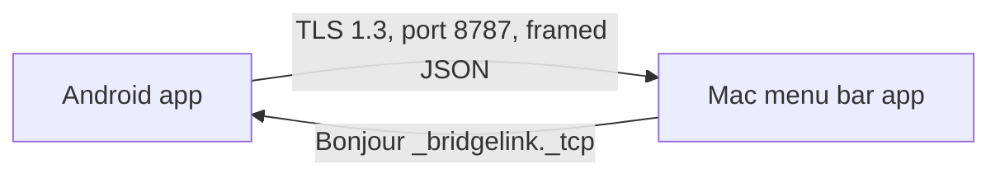

# Architecture

The phone is the TCP client. The Mac is the listener. Both speak the frames in `docs/PROTOCOL.md`.

## Android

`LinkService` is a foreground service of type `connectedDevice`. The class itself only keeps the names the rest of the app already uses. `LinkCore` owns the socket. `LinkDesk` owns clipboard, alerts, files, ringing, and battery. `LinkInbox` owns incoming messages. Socket reads run on the connection thread. Socket writes run on a single thread named `bridgelink-writer`, so the main thread never writes to the network. `BootReceiver` reconnects after boot when a host and token are saved. `ConnectivityManager` does the same after a network change. `MacBrowser` resolves the Bonjour service. `Prefs` stores the token and fingerprint.

## Mac

A Swift package builds the menu-bar app. `BridgeLinkCore` is the codec, PIN gate, and pairing link. `BridgeLink` owns the listener, the keychain identity, and the SwiftUI window. A new TCP connection stays pending until its hello carries the saved token or the current PIN. Only then does it replace the live connection.

## What is not here

There is no remote-link process, no push provider, and no database shared by the two apps. The browser demo does not speak this protocol.
